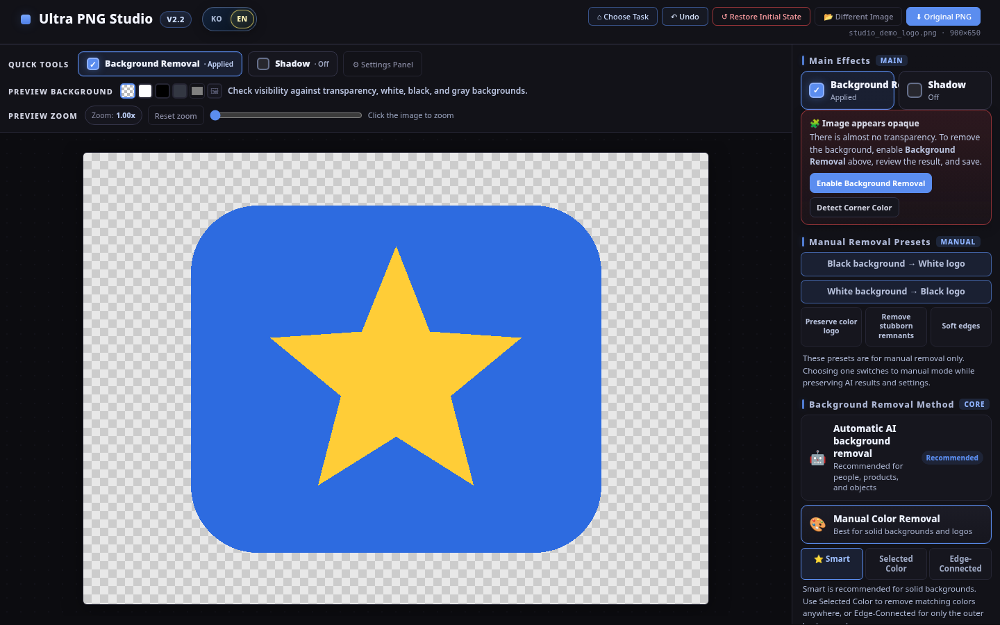
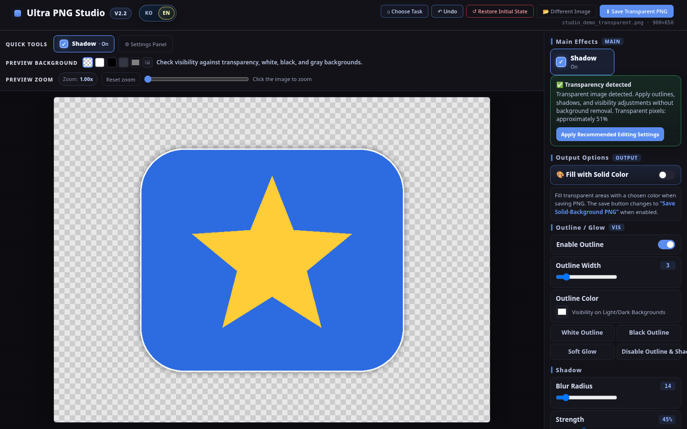
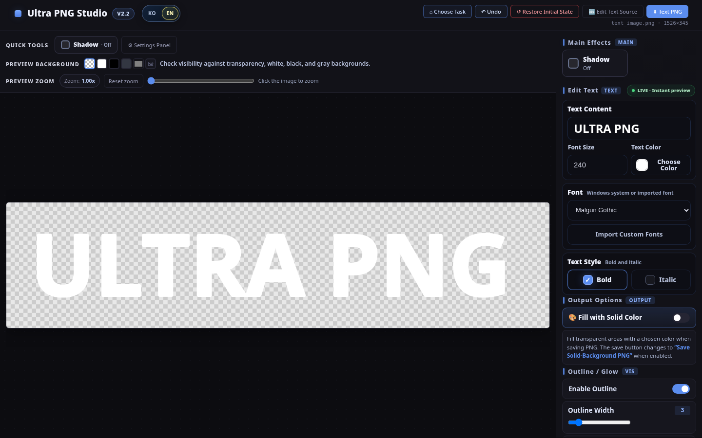
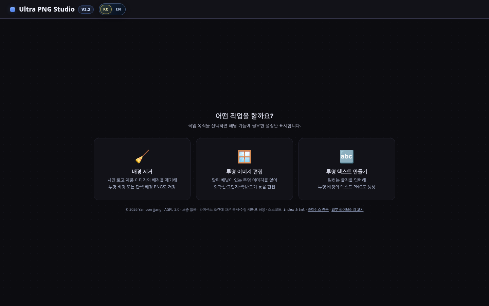
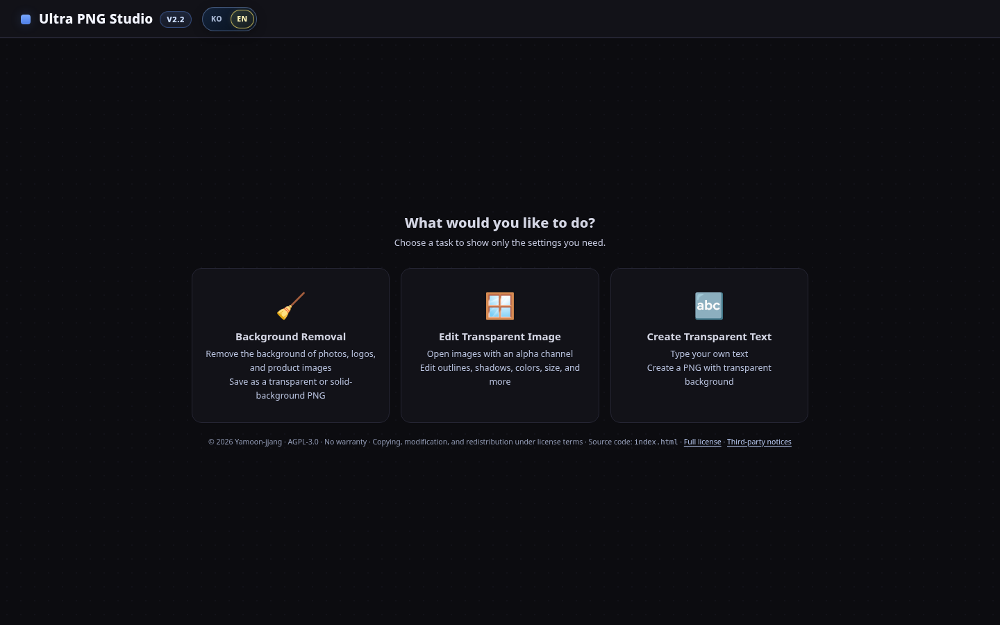

# Ultra PNG Studio v2.2

**한국어** · [English](#english) · [사용 설명서](docs/manual.md) · [English manual](docs/manual_en.md)

브라우저에서 바로 실행하는 **설치 없는 단일 HTML 이미지 편집 도구**입니다. 사진·로고의 배경을 지우고, 투명 PNG를 보정하고, 원하는 문구를 투명 PNG로 만들 수 있습니다. **한국어 / English UI를 모두 지원**합니다.

## 세 가지 작업 / Three ways to create

| 🧹 배경 제거 · Background Removal | 🪟 투명 이미지 편집 · Transparent Editing | 🔤 텍스트 PNG · Text to PNG |
|---|---|---|
|  |  |  |
| AI 자동 제거 또는 단색 배경 수동 제거 (스마트 / 지정 색상 / 가장자리 연결) | 외곽선, 글로우, 그림자, 색상, 회전·반전, 자동 자르기 | 텍스트 입력, 시스템/사용자 글꼴, 실시간 미리보기, PNG 생성 |

## 주요 기능

| 기능 | 설명 |
|---|---|
| **KO / EN 전환** | Ultra Exif Reader와 통일된 상단 `KO` / `EN` 스위치. 브라우저 언어 자동 감지 및 수동 선택 기억. 메뉴·설정·도움말·오류 알림까지 전환 |
| **AI 배경 제거** | 사람·제품·사물 사진의 배경을 브라우저에서 자동 제거. AI 경계 페더링 및 단색 배경 채우기 |
| **수동 배경 제거** | 단색 배경 로고·스캔 이미지에 적합. 스마트 / 지정 색상 / 가장자리 연결 + 제거 프리셋 |
| **투명 이미지 편집** | 외곽선, 글로우, 그림자, 밝기·대비·채도, 회전·반전, 자동 자르기, 정사각형 배치 |
| **텍스트 PNG** | 시스템 글꼴 및 사용자 글꼴(TTF / OTF / WOFF / WOFF2), 굵기·기울기, 실시간 편집 |
| **저장과 복구** | 투명 PNG / 배경 포함 미리보기 PNG / 흰 배경 JPG / 실행취소 / 다시실행 / 처음 상태 복구 |
| **SVG 지원** | viewBox-only SVG의 고해상도 렌더링, 한쪽 길이만 있는 SVG 및 네임스페이스 SVG 지원 |

### 한글·영문 화면 비교 / Interface language switch

| KO | EN |
|---|---|
|  |  |

상단의 **KO / EN** 버튼을 누르면 진행 중인 작업을 닫지 않고 화면 언어만 바뀝니다. 한국어 브라우저는 기본 한국어, 그 외 언어 브라우저는 기본 영어이며, 수동 선택을 우선합니다. 저장된 언어 선호도는 브라우저 저장소 정책에 따라 유지됩니다. **사용자가 입력한 문구, 파일 이름, 글꼴 내부 값, 이미지 데이터는 번역·수정하지 않습니다.**

## 다운로드와 실행

1. [Releases](https://github.com/Yamoon-jjang/Ultra-PNG-Studio/releases)에서 배포 ZIP을 내려받거나 `Code → Download ZIP`을 선택합니다. **저장소가 아직 공개되지 않았다면 이 링크는 열리지 않습니다.**
2. 압축을 풀고 `index.html`을 Chrome 또는 Edge에서 엽니다. 별도 프로그램 설치는 필요하지 않습니다.
3. 작업 유형을 선택하고 파일을 불러오거나 텍스트를 입력합니다. 편집 후 상단/오른쪽의 저장 버튼으로 내보냅니다.

GitHub Pages를 활성화하면 HTTPS 웹 페이지로도 이용할 수 있습니다. GitHub Pages 주소는 게시 후 제공되며, 현재 문서에는 아직 게시된 주소를 기재하지 않았습니다.

## 글꼴 및 저작권

**글꼴 파일은 저장소와 배포 ZIP에 포함하지 않습니다.** Windows에서 사용 가능한 시스템 글꼴을 선택하거나, 사용자가 합법적으로 다운로드한 TTF/OTF/WOFF/WOFF2 파일을 **커스텀 폰트 불러오기**로 직접 선택할 수 있습니다. 실제 글꼴 파일은 선택된 경우에만 로드하고 서버로 업로드하지 않습니다. 글꼴을 사용할 때는 각 글꼴의 사용 허가를 확인하세요.

추천 공식 경로: [Pretendard](https://github.com/orioncactus/pretendard) · [네이버 나눔글꼴](https://hangeul.naver.com/font) · [Google Fonts](https://fonts.google.com/).

## 개인정보·네트워크·AI 주의 사항

이미지 편집 및 저장은 브라우저 내에서 처리됩니다. 이 앱에는 **이미지 업로드 서버가 없습니다.** 단, AI 자동 배경 제거를 처음 사용할 때는 IMG.LY 라이브러리, WASM 및 모델 파일을 `cdn.jsdelivr.net`과 `staticimgly.com` 등 외부 CDN에서 내려받으므로 인터넷 연결이 필요합니다. 브라우저 캐시와 보안 정책에 따라 다음 실행 여부 및 속도는 달라집니다.

**검증 범위:** Chromium 자동화에서 이미지 처리와 언어 전환을 시험했습니다. Windows에서의 직접 HTML 실행, 실제 CDN/WASM/AI 모델 다운로드·실추론, GitHub Pages HTTPS 동작은 아직 사용자 PC 확인이 필요합니다. [배포 전 실제 테스트 체크리스트](docs/TEST_BEFORE_GITHUB_RELEASE.md)를 확인하세요.

## 문서

- [한국어 상세 사용 설명서](docs/manual.md) / [Complete English manual](docs/manual_en.md)
- [v2.2 릴리즈 노트 / Release notes](docs/RELEASE_NOTES_v2.2.md)
- [배포 전 PC 테스트 체크리스트](docs/TEST_BEFORE_GITHUB_RELEASE.md)
- [자동화 검증 결과 및 미검증 항목](docs/TEST_REPORT.md)
- [외부 구성 요소 고지](THIRD_PARTY_NOTICES.md) / [AGPL-3.0 LICENSE](LICENSE)

---

## English

**Ultra PNG Studio v2.2** is a **single-file, browser-based image editor** for background removal, transparent-image effects and text-to-PNG creation. No installation, account or image-upload service is required.

Its **KO / EN interface** matches the segmented language switch in Ultra Exif Reader. The app automatically chooses Korean for Korean browser locales or English otherwise; you can switch at any time without losing your image or text. Your manual choice is remembered where browser storage is available.

The three screenshots at the top demonstrate the main modes: **AI/manual background removal**, **transparent-image editing**, and **live text PNG creation**. Features include Smart/Color/Edge-Connected manual removal, outlines and shadows, color adjustments, rotation/flip, tile preview, auto-crop, square output, PNG/JPG exports and Undo/Redo/Restore.

**Fonts:** No TTF/OTF/WOFF/WOFF2 files are bundled. Use local system fonts or import your own legitimately obtained font files. Imported font data is read locally and is not uploaded or persisted by this application.

**How to run:** Extract the ZIP and open `index.html` in a current version of Chrome or Edge. GitHub Pages can also host the site over HTTPS once the repository has been published. AI background removal downloads code/model assets from external CDNs on first use, so it requires internet access; editing and export remain local in your browser.

**Testing caveat:** Automated Chromium checks cover the modes, exports, i18n and mocked AI. Real AI inference, Windows local-file execution and GitHub Pages deployment still require real-world testing before a public release.

See the [English manual](docs/manual_en.md), [v2.2 release notes](docs/RELEASE_NOTES_v2.2.md), [pre-release test checklist](docs/TEST_BEFORE_GITHUB_RELEASE.md), and [third-party notices](THIRD_PARTY_NOTICES.md).

**License:** [GNU AGPL-3.0](LICENSE). The AI background-removal integration uses [IMG.LY Background Removal](https://github.com/imgly/background-removal-js), also licensed under AGPL-3.0. See dependency and Microsoft ONNX Runtime Web licensing details in [THIRD_PARTY_NOTICES.md](THIRD_PARTY_NOTICES.md).
