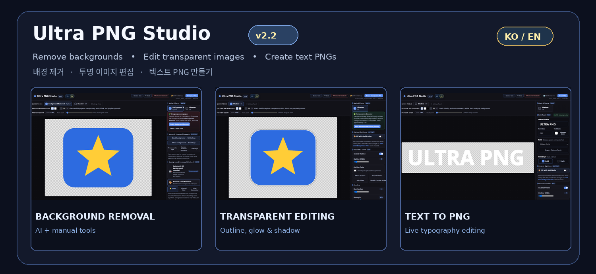
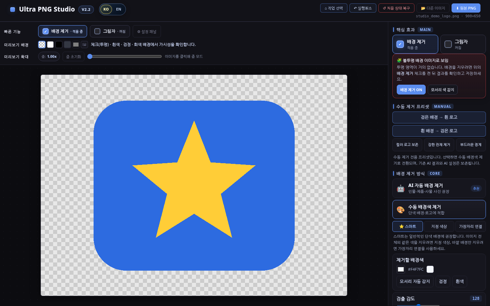
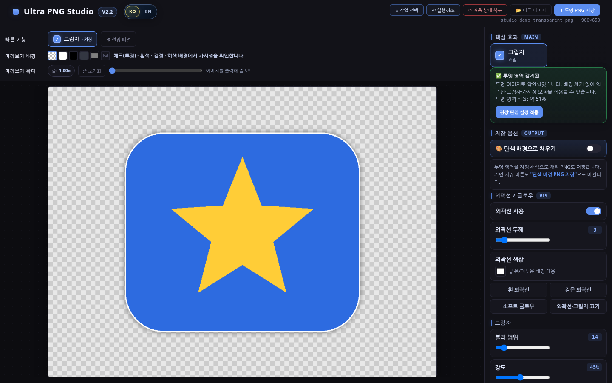

# 🎨 Ultra PNG Studio v2.2

**AI Background Remover · Transparent PNG Editor · Text PNG Maker**

**한국어 / English** · **브라우저에서 실행하는 단일 HTML 앱 / One HTML file, no installation**

[📦 **v2.2 다운로드 / Download**](https://github.com/Yamoon-jjang/Ultra-PNG-Studio/releases/latest) · [🇰🇷 한국어 매뉴얼](docs/manual.md) · [🇺🇸 English Manual](docs/manual_en.md) · [📝 v2.2 변경 사항](docs/RELEASE_NOTES_v2.2.md)

> **사진 배경 제거부터 투명 PNG 편집, 글자 PNG 제작까지 한곳에서.** 설치 프로그램이나 별도의 이미지 업로드 서버 없이 Chrome·Edge에서 실행할 수 있는 이미지 편집 도구입니다.
>
> **Remove backgrounds, polish transparent graphics and create text PNGs in one place.** Runs in Chrome or Edge without an installer or a separate image-upload server.

---

## 🖼️ 세 가지 작업 / Three editing modes

| ✨ 배경 제거 / Background Remover | 🪄 투명 이미지 편집 / Transparent PNG Editor | 🔤 텍스트 PNG / Text PNG Maker |
| :---: | :---: | :---: |
|  |  |  |
| AI 자동 제거 · 수동 배경색 제거 | 외곽선 · 그림자 · 이미지 효과 | 사용자 글꼴 · 실시간 텍스트 미리보기 |
| AI and manual background removal | Outlines, shadows and image effects | Custom fonts and live text preview |

### ① ✨ 배경 제거 / AI & Manual Background Removal

| 한국어 화면 | English UI |
| :---: | :---: |
|  |  |

- **AI 자동 제거:** 인물·제품·사물 사진 등의 배경을 AI 모델로 분리하고 투명 PNG로 저장합니다. *첫 사용 시 모델과 실행 파일 다운로드에 인터넷 연결이 필요합니다.*
- **수동 제거 3방식:** 스마트, 지정 색상, 가장자리 연결 방식으로 단색 배경이나 로고·도안의 배경을 제거합니다.
- **결과 다듬기:** 투명도, 경계 페더링, 단색 배경, 출력 영역 및 저장 옵션을 조절합니다.

**EN:** Automatically remove backgrounds with AI (requires a first-time online model download), or use Smart / Selected Color / Edge-Connected manual removal for simple backgrounds and graphics. Refine the result before exporting.

### ② 🪄 투명 이미지 편집 / Transparent PNG Editing

| 한국어 화면 | English UI |
| :---: | :---: |
|  |  |

- **이미지 효과:** 외곽선, 글로우, 그림자, 밝기·대비·채도 등 세부 설정
- **배치와 크기:** 회전·반전, 자동 자르기, 정사각형 출력, 타일 미리보기
- **안전한 편집:** 실행취소·다시실행·처음 상태 복구와 PNG/JPG 출력

**EN:** Add outlines, glow and shadows; adjust brightness, contrast and saturation; flip or rotate images; use auto-crop, square layout and tiled preview. Undo, redo and restore are available.

### ③ 🔤 텍스트 PNG 제작 / Text PNG Maker

| 한국어 화면 | English UI |
| :---: | :---: |
|  |  |

- **투명 배경 문자 이미지:** 문구를 입력하고 크기·색상·글꼴·굵기·기울기를 조절합니다.
- **실시간 미리보기:** 설정을 바꾸면서 결과를 확인하고 PNG로 저장합니다.
- **사용자 글꼴:** Windows 시스템 글꼴 또는 직접 선택한 TTF · OTF · WOFF · WOFF2 파일 사용

**EN:** Create transparent text graphics, adjust text appearance with a live preview, and import your own font files. No fonts are redistributed in this repository.

---

## 🌐 KO / EN — 화면 언어 전환 / Language Switch

| 🇰🇷 Korean | 🇺🇸 English |
| :---: | :---: |
|  |  |

- 상단 **KO / EN** 버튼은 [Ultra Exif Reader](https://github.com/Yamoon-jjang/Ultra-Exif-Reader)와 동일한 캡슐형 디자인입니다.
- 브라우저 언어를 바탕으로 기본 언어를 고르고, 사용자가 직접 변경하면 브라우저 저장소가 허용할 때 선택을 기억합니다.
- 작업 중 언어만 전환하며 **사용자 입력 텍스트, 파일 이름, 글꼴 선택값, 이미지 데이터, 실행취소 기록은 변경하지 않습니다.**

**EN:** The segmented KO/EN switch matches Ultra Exif Reader. Browser language determines the initial UI; a manual selection can be remembered. Switching UI language preserves your text, filename, font settings, image and edit history.

## 🚀 다운로드와 실행 / Download & Run

**한국어**

1. [**Releases에서 v2.2 ZIP 다운로드**](https://github.com/Yamoon-jjang/Ultra-PNG-Studio/releases/latest) 후 압축을 풉니다.
2. 압축을 푼 `Ultra-PNG-Studio/index.html`을 **Chrome 또는 Edge**로 엽니다.
3. 배경 제거, 투명 이미지 편집, 텍스트 PNG 중 하나를 선택합니다.
4. 이미지 또는 문구를 불러와 편집한 다음 PNG/JPG로 저장합니다.

**English**

1. [**Download the latest release ZIP**](https://github.com/Yamoon-jjang/Ultra-PNG-Studio/releases/latest) and extract it.
2. Open `Ultra-PNG-Studio/index.html` in **Chrome or Edge**.
3. Choose Background Remover, Transparent PNG Editor or Text PNG Maker.
4. Load an image or enter text, edit, then export PNG/JPG as supported by the mode.

No installer, login or local server is required. GitHub Pages hosting is possible after Pages is enabled; this README does not claim a live Pages URL.

### 📋 지원 기능 한눈에 보기 / Feature checklist

| 기능 / Feature | 설명 / Description |
|---|---|
| AI / 수동 배경 제거 | AI removal; Smart, Selected Color and Edge-Connected manual modes |
| 투명 이미지 효과 | Outlines, glow, shadows, color adjustments, flip and rotation |
| SVG 불러오기 | High-resolution viewBox SVG; single-dimension and namespace-prefixed SVG handling |
| 저장 이름 | Source-based names, including Unicode / Korean / emoji filenames |
| 편집 복구 | Undo, Redo and Restore to Initial State |
| 출력 | Transparent PNG, solid-background output and JPG options |
| 사용자 글꼴 | Local system fonts; user-selected TTF, OTF, WOFF and WOFF2 |
| UI 언어 | Automatic KO/EN selection, manual switch, remembered preference when available |

## 🔠 글꼴 사용과 저작권 / Fonts & Redistribution

**글꼴 바이너리는 GitHub 저장소나 Release ZIP에 포함되어 있지 않습니다.** 저작권 및 재배포 조건을 존중하기 위한 구성입니다. 글꼴 선택 기능은 그대로 사용할 수 있습니다.

- Windows에 설치된 글꼴을 선택하거나 **커스텀 폰트 불러오기**에서 직접 보유한 글꼴 파일을 선택하세요.
- 개별 글꼴의 사용·상업적 사용·재배포 허용 범위는 해당 제공처의 라이선스를 확인하세요.
- 참고 경로: [Pretendard](https://github.com/orioncactus/pretendard) · [네이버 나눔글꼴](https://hangeul.naver.com/font) · [Google Fonts](https://fonts.google.com/)

**EN:** No third-party font files are bundled. Use your installed fonts or import legally obtained font files locally, subject to each font's license.

## 🔒 개인정보·네트워크·AI / Privacy, Network & AI

- 일반 편집과 저장은 브라우저에서 이루어지며, **앱 자체의 이미지 업로드 서버는 없습니다.**
- AI 자동 배경 제거는 처음 사용할 때 IMG.LY 라이브러리, ONNX/WASM 구성요소 및 모델을 외부 CDN에서 다운로드합니다. 인터넷 연결과 브라우저 리소스가 필요합니다.
- 초고해상도 입력에는 캔버스 크기와 메모리 보호 제한이 있습니다. 일부 SVG는 렌더링 후 입력되며, 특수한 SVG는 결과를 확인하세요.
- **자동화 테스트와 실사용 검증은 다릅니다.** Chromium 자동화에서 기능·언어 전환·경계 사례를 검사했지만 실제 Windows 로컬 HTML의 AI 모델 다운로드·추론 및 GitHub Pages에서의 AI 실행은 별도 확인이 필요합니다.

**EN:** Image editing and exports run locally; this application has no dedicated image-upload server. AI background removal downloads third-party code, WASM and model assets over the network. Large images can reach canvas or memory safety limits. Real model inference on Windows and GitHub Pages was not established by the automated test suite.

## 📚 설명서·릴리즈·검증 / Documentation

| 문서 / Resource | 내용 / Details |
|---|---|
| [🇰🇷 한국어 사용 설명서](docs/manual.md) | 모드별 설정과 사용법 / Korean guide |
| [🇺🇸 English user manual](docs/manual_en.md) | Full English guide |
| [📦 v2.2 Release](https://github.com/Yamoon-jjang/Ultra-PNG-Studio/releases/tag/v2.2) | Download and version-specific changes |
| [📝 v2.2 변경 내역 / Release Notes](docs/RELEASE_NOTES_v2.2.md) | Concise bilingual changelog |
| [✅ 테스트 보고서 / Test Report](docs/TEST_REPORT.md) | Automated checks and coverage |
| [🧪 PC 실사용 체크리스트](docs/TEST_BEFORE_GITHUB_RELEASE.md) | Checks for real Chrome/Edge environments |
| [⚖️ Third-party notices](THIRD_PARTY_NOTICES.md) | External licenses and dependencies |

**License:** [GNU AGPL-3.0](LICENSE) · **Developer:** [Yamoon-jjang](https://github.com/Yamoon-jjang)

---

**One Studio · Three Editing Modes · Two Languages**
