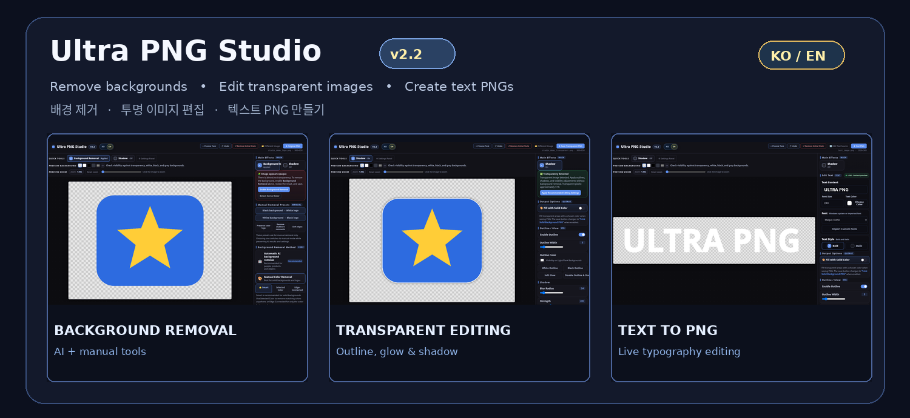

# 🎨 Ultra PNG Studio v2.2 — KO / EN

**AI Background Remover · Transparent PNG Editor · Text PNG Maker**

**📦 [Download v2.2 ZIP](https://github.com/Yamoon-jjang/Ultra-PNG-Studio/releases/download/v2.2/Ultra-PNG-Studio_v2.2.zip)** · [GitHub README](https://github.com/Yamoon-jjang/Ultra-PNG-Studio) · [Korean Manual](https://github.com/Yamoon-jjang/Ultra-PNG-Studio/blob/main/docs/manual.md) · [English Manual](https://github.com/Yamoon-jjang/Ultra-PNG-Studio/blob/main/docs/manual_en.md)

---

## 🇰🇷 한국어 — v2.2 주요 변경

**설치 없이 브라우저에서 실행하는 이미지 편집 도구에 한국어·영어 공용 UI를 적용했습니다.**

- **KO / EN 전환:** Ultra Exif Reader와 디자인을 통일한 캡슐형 언어 스위치
- **자동 언어 선택:** 브라우저 언어에 맞춰 표시하고, 수동 선택은 저장소가 허용하는 경우 기억
- **화면 전반 번역:** 세 작업 모드의 메뉴·버튼·설정·도움말·진행 상태·오류 안내
- **작업 상태 보존:** 언어를 전환해도 이미지, 입력 텍스트, 글꼴 설정, 실행취소 기록 유지
- **캔버스 경고 수정:** 띄어쓰기가 있는 작업 이름도 영어 안전 제한 메시지로 정상 변환

### 포함 기능

✨ **AI·수동 배경 제거** · 🪄 **투명 PNG 편집** · 🔤 **텍스트 PNG 제작** · SVG 고해상도 입력 · 외곽선·그림자 · 사용자 글꼴 직접 불러오기 · PNG/JPG 출력 · Undo/Redo/Restore

**실행 방법:** ZIP을 내려받아 압축을 풀고 `Ultra-PNG-Studio/index.html`을 Chrome 또는 Edge로 열어 사용하세요. 별도 설치 프로그램은 필요하지 않습니다.

---

## 🇺🇸 English — What's New in v2.2

**Ultra PNG Studio is a portable, single-file browser editor, now with a Korean/English interface.**

- **KO / EN language switch:** Segmented control matching Ultra Exif Reader
- **Automatic locale selection:** Browser language sets the default; manual preference is remembered when storage permits
- **Bilingual controls:** Menus, settings, tooltips, task statuses and error guidance
- **Preserved editing state:** Switching languages keeps images, entered text, font settings and undo history
- **Canvas warning fix:** Safety-limit messages translate correctly even when operation names contain spaces

### Included Features

✨ **AI/manual background removal** · 🪄 **Transparent PNG editing** · 🔤 **Text PNG creation** · High-resolution SVG import · Outlines and shadows · Local custom fonts · PNG/JPG export · Undo/Redo/Restore

**Getting started:** Download and extract the ZIP, then open `Ultra-PNG-Studio/index.html` in Chrome or Edge. No installer is required.

---

### 🧪 Testing & Notes / 검증 및 주의 사항

- Automated checks: **83/83** existing-function regressions, **43/43** edge cases, **49/49** language/mobile/state checks, and **48/48** canvas warning tests.
- **Real AI inference is not part of those results.** First-time AI background removal downloads third-party libraries, WASM and a model from external CDNs; test real Windows execution and network access separately.
- Image editing and export run in the browser; no app-owned image-upload server is required.
- **License:** [GNU AGPL-3.0](https://github.com/Yamoon-jjang/Ultra-PNG-Studio/blob/main/LICENSE). No font binaries are bundled. [Third-party notices](https://github.com/Yamoon-jjang/Ultra-PNG-Studio/blob/main/THIRD_PARTY_NOTICES.md).

**Made by [Yamoon-jjang](https://github.com/Yamoon-jjang)** · One Studio · Three Editing Modes · Two Languages
